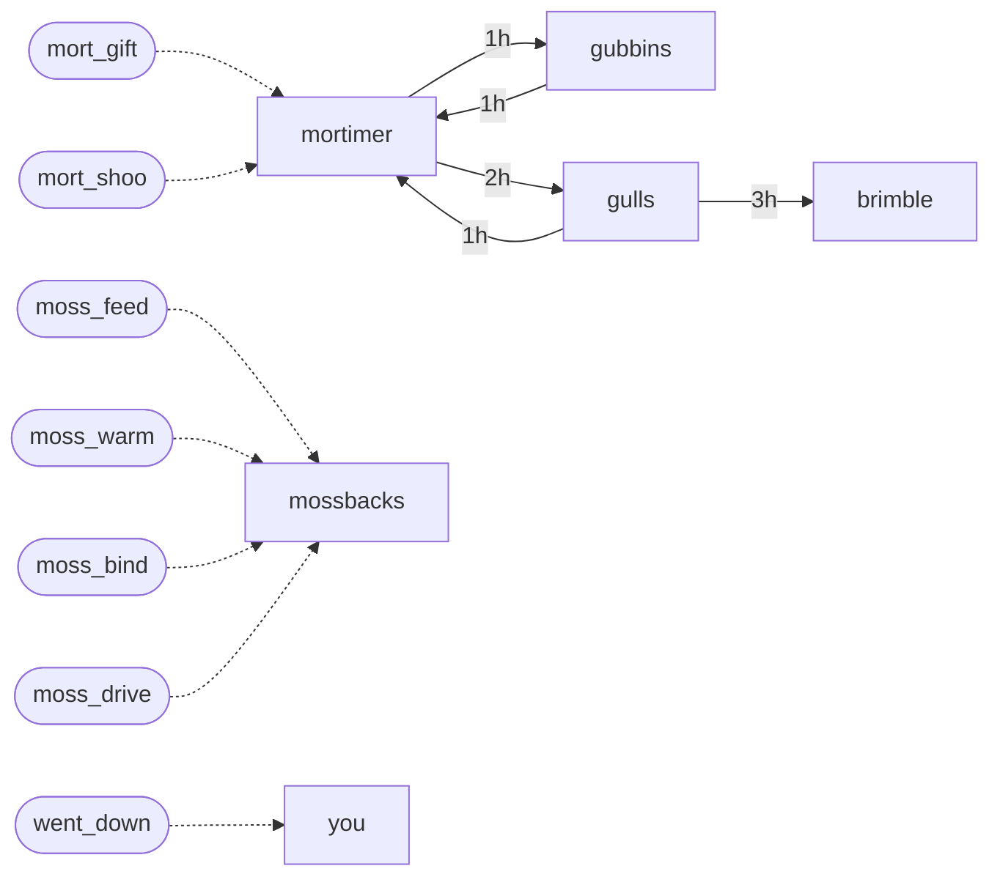

# Tidecrown world graph

Written by tools/world-graph.js from src/js/32-world-registry.js. Do not edit by hand.

## Who

| Who | Kind | Sees | Tells (game hours, certainty kept) |
|---|---|---|---|
| Mortimer Gull (mortimer) | dweller | key | gubbins (1h, 0.85), gulls (2h, 0.8) |
| Gubbins (gubbins) | dweller | key | mortimer (1h, 0.85) |
| Brimble (brimble) | dweller | key | - |
| the gulls (gulls) | flock | key, forest | mortimer (1h, 0.7), brimble (3h, 0.7) |
| the Mossbacks (mossbacks) | creature | - | - |

## Deeds

| Deed | Hand | Subject | Where | Regard moves | Can reach |
|---|---|---|---|---|---|
| mort_gift: gave Mortimer a golden fish | accord | mortimer | key | t+0.2 f-0.1 w+0.4 | mortimer, gubbins, brimble, gulls |
| mort_shoo: shooed Mortimer off his post | strife | mortimer | key | t-0.3 f+0.5 w-0.4 | mortimer, gubbins, brimble, gulls |
| moss_feed: fed a Mossback | accord | mossbacks | forest | t+0.1 f-0.05 w+0.35 | gulls, mortimer, brimble, gubbins |
| moss_warm: warmed a shivering Mossback | accord | mossbacks | forest | t+0.1 w+0.3 | gulls, mortimer, brimble, gubbins |
| moss_bind: kept a Mossback | accord | mossbacks | forest | t+0.2 w+0.4 | gulls, mortimer, brimble, gubbins |
| moss_drive: drove off a Mossback | strife | mossbacks | forest | t-0.15 f+0.3 w-0.3 | gulls, mortimer, brimble, gubbins |
| went_down: went under (drowned or collapsed) | none | you | key, forest |  | mortimer, gubbins, brimble, gulls |

## Events

| Event | Outcome | When | Gift |
|---|---|---|---|
| gubbins_mood | warm | w >= 0.25 | Gubbins says which way the fish are biting (knowledge) |
| gubbins_mood | afraid | f >= 0.25 | Gubbins pays a shell more per fish (goods) |
| brimble_mood | warm | w >= 0.25 | Brimble reads the next shower and monsoon for you, a day ahead (knowledge) |
| brimble_mood | afraid | f >= 0.25 | Brimble cooks your raw fish for you: always plain cooked, no XP (labour) |
| mortimer_mood | warm | w >= 0.25 | Mortimer tells you how Gubbins and Brimble feel about you (knowledge) |
| mortimer_mood | afraid | f >= 0.25 | Mortimer slides you five shells at the bank, once a day (goods) |

## Style picture

| Axis | Ends | Fed by |
|---|---|---|
| hand | Strife / Accord | deed hands |
| roam | homebody / roamer | where deeds happen (the Key or beyond) |
| pace | hasty / patient | patient |
| care | reckless / careful | reckless |
